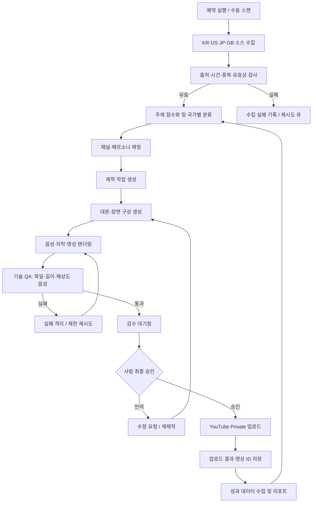
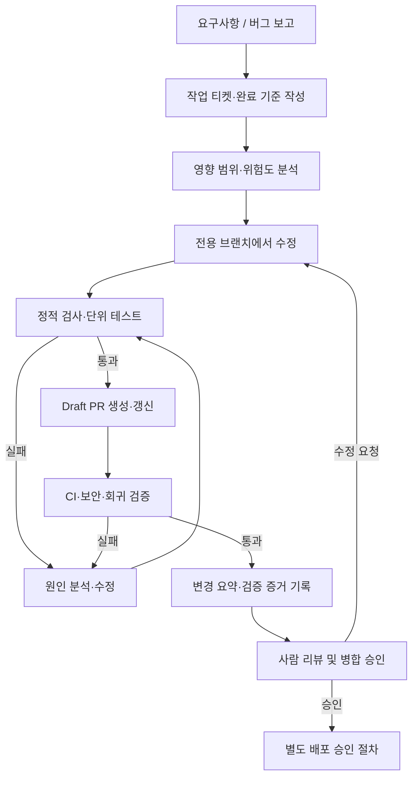

# NEXUS STUDIO PRO — 업무 워크플로우 및 단계별 자동화 계획

- 문서 상태: **초안 / 구현 기준서**
- 적용 브랜치: `fix/shorts-runtime-security-bootstrap`
- 목적: 현재 수동·반자동으로 연결된 업무를 명확한 단계와 상태로 정의하고, 검증 가능한 단위부터 자동화한다.
- 운영 원칙: **자동 수집·분석·초안 제작은 자동화하되, 최종 승인과 외부 공개는 사람의 통제 아래 둔다.**
- 이 문서는 목표 설계와 현재 구현 상태를 구분한다. 계획에 적힌 기능을 이미 구현된 것으로 간주하지 않는다.

---

## 2026-11-27 검증 갱신

- FastAPI 브라우저 인증은 기본 필수이며 비밀값 누락 시 fail-closed합니다. Browser Studio는 세션 상태 확인 → 운영자 로그인 → HttpOnly/SameSite 세션 → 만료 시 재로그인 흐름을 사용합니다.
- Docker 운영 이미지에서 실제 세로형 H.264/AAC MP4를 생성하고 ffprobe QA까지 수행하는 별도 통합 테스트를 추가했습니다. FFmpeg/MoviePy 리소스와 실패한 임시 산출물도 정리합니다.
- Playwright Chromium으로 네 가지 디자인 테마의 실제 레이아웃 차이, 색상 스킨 독립성, 샘플 토글, 워크스페이스 이동, 모바일 전환을 검사합니다.
- Windows 운영자용 scripts/setup-local-nexus.ps1 및 scripts/verify-local-nexus.ps1를 추가했습니다. 이 스크립트들은 원격 CI에서 문법·계약을 검사하며, Windows 호스트에서의 실제 실행은 아직 대기입니다.
- Vercel Preview는 정적 UI 전용이며 FastAPI/SQLite 운영 백엔드와 연결되지 않습니다. 무료 배포 일일 제한으로 최신 커밋 배포가 차단될 수 있습니다.
- Google/YouTube OAuth, Private 업로드, YouTube Analytics 읽기 권한은 실계정 연결 및 Windows 호스트에서 검증해야 합니다. 성과 데이터는 권한 연결 전까지 계속 null/미수집으로 둡니다.
## 1. 운영 목표와 자동화 경계

### 1.1 목표

1. KR / US / JP / GB의 트렌드 및 콘텐츠 소스를 주기적으로 수집한다.
2. 출처·수집 시각·국가·주제·중복 여부를 보존하고, 근거가 없는 조회수나 성장률을 만들어내지 않는다.
3. 10개 채널의 카테고리와 페르소나에 주제를 배정한다.
4. 대본·내레이션·자막·세로형 영상을 자동 제작한다.
5. 렌더링 결과를 자동 점검하고, 실패 항목은 재시도 또는 격리한다.
6. 검수자가 영상·제목·대본·출처를 확인하고 승인한다.
7. 승인된 영상만 YouTube에 **비공개(Private)** 로 업로드한다.
8. 성과 데이터는 다음 편성에 참고하되, 자동 공개·무단 재업로드는 하지 않는다.

### 1.2 자동화 허용 범위와 사람 승인 범위

| 업무 | 목표 실행 방식 | 사람 승인 |
|---|---|---|
| RSS/Hacker News 수집 | 자동 | 불필요 |
| 출처 검증·중복 제거·주제 분류 | 자동 + 품질 규칙 | 예외 건만 |
| 채널 매칭·제작 후보 편성 | 자동 추천 | 정책 예외 시 |
| 대본·이미지·음성·영상 생성 | 자동 | 검수 전에는 배포 금지 |
| 기술적 영상 검사 | 자동 | 실패·경고 항목 확인 |
| 사실성·저작권·브랜드 적합성 검수 | 보조 자동화 + 사람 검수 | **필수** |
| YouTube 비공개 업로드 | 승인 후 실행 | **업로드 전 승인 필수** |
| 공개(Public) 전환·게시 | 자동화 대상 아님 | 별도 명시적 사람 조작 |

---

## 2. 콘텐츠 운영 전체 워크플로우



### 2.1 단계별 업무 정의

| 단계 | 입력 | 수행 업무 | 출력 / 완료 조건 |
|---|---|---|---|
| W01 수집 | 국가별 피드·수집 설정 | RSS/HN 요청, 응답 코드·시각·원문 URL 기록 | 원문 근거가 있는 후보 목록 |
| W02 정제 | 수집 후보 | 제목 정규화, 중복 제거, 빈 제목·잘못된 URL 제외 | 정제된 주제 레코드 |
| W03 분석 | 정제 주제 | 국가·카테고리·신뢰도·인기도 신호 평가 | 근거 필드가 채워진 추천 목록 |
| W04 편성 | 추천 목록·채널 정책 | 채널 매칭, 중복 제작 확인, 일일 제작량 제한 | 승인 가능한 제작 작업 |
| W05 대본 | 작업·채널 페르소나 | 훅·핵심 설명·마무리 구성, 사실 확인용 출처 연결 | 버전이 기록된 대본 |
| W06 렌더링 | 대본·음성·비주얼 자산 | TTS, 자막, 9:16 MP4 생성 | 렌더링 파일과 메타데이터 |
| W07 자동 QA | MP4·대본·메타데이터 | 파일 존재·크기·코덱·해상도·길이·오디오 확인 | PASS 또는 구체적인 실패 사유 |
| W08 사람 검수 | 영상·대본·출처·QA | 사실성·저작권·표현·브랜드·품질 확인 | 승인 또는 반려 기록 |
| W09 비공개 업로드 | 승인된 작업 | OAuth 확인, YouTube 업로드, 응답 검증 | Private 영상 ID와 업로드 상태 |
| W10 성과 분석 | 영상 ID·성과 지표 | 조회·시청 지속·반응 지표 수집 | 다음 편성에 활용할 리포트 |

### 2.2 업무 상태 모델

작업 상태는 아래의 단방향 전이를 기본으로 한다. 임의 상태 변경은 감사 로그 없이 허용하지 않는다.

```text
DISCOVERED
  -> NORMALIZED
  -> PLANNED
  -> SCRIPTING
  -> RENDERING
  -> QA_PENDING
  -> REVIEW_PENDING
  -> APPROVED
  -> UPLOADING_PRIVATE
  -> UPLOADED_PRIVATE

예외 상태:
COLLECT_FAILED / SCRIPT_FAILED / RENDER_FAILED / QA_FAILED
REJECTED / RETRY_WAIT / CANCELLED
```

- `APPROVED`는 사람의 명시적 승인 이벤트가 있어야 진입한다.
- `UPLOADING_PRIVATE`는 승인된 작업에만 허용한다.
- 업로드 성공은 YouTube 응답의 영상 ID와 비공개 상태를 확인한 뒤 기록한다.
- 업로드 실패는 원인과 재시도 가능 여부를 기록한다. 중복 업로드 가능성이 있으면 자동 재시도하지 않고 확인 대기 상태로 둔다.
- 공개 상태로 전환하는 자동 작업은 만들지 않는다.

---

## 3. 개발·유지보수 업무 워크플로우

콘텐츠 제작 흐름과 별도로, 소프트웨어 변경은 아래의 개발 파이프라인을 따른다.



### 3.1 개발 작업 필수 필드

모든 작업은 다음 정보를 갖도록 한다.

- 고유 작업 ID와 우선순위
- 문제·목표·사용자 영향
- 변경 대상 파일 및 모듈
- 선행 작업과 차단 요인
- 완료 조건(테스트 가능한 문장)
- 위험 등급: 낮음 / 중간 / 높음
- 실행 상태와 담당 역할
- 브랜치·커밋·PR 링크
- 테스트 명령 및 실제 결과
- 미검증 항목과 운영 영향

### 3.2 개발 완료 조건

다음 조건을 모두 충족하기 전에는 작업을 완료로 표시하지 않는다.

1. 요구사항의 완료 기준을 충족한다.
2. 관련 단위·통합 테스트가 실제 실행되어 통과한다.
3. 보안·데이터 보호·기존 기능 회귀를 확인한다.
4. PR에 변경 내용, 검증 근거, 남은 위험을 기록한다.
5. 실패·미검증 항목이 있으면 미완료 또는 차단 상태로 남긴다.
6. main 병합과 운영 배포는 별도 승인 절차를 거친다.

---

## 4. 자동화 구성요소 및 책임 분리

| 구성요소(목표) | 책임 | 입력 | 출력 | 장애 처리 |
|---|---|---|---|---|
| Scheduler | 주기·시간 기반 실행 | 운영 설정 | 실행 이벤트 | 중복 실행 방지 키 |
| Collector | 국가별 소스 수집 | 피드 목록 | 원문 후보 | 소스별 timeout·재시도 |
| Normalizer | 정규화·중복 제거 | 원문 후보 | 표준 주제 | 격리 테이블 |
| Planner | 점수화·채널 배정 | 표준 주제·채널 정책 | 제작 작업 | 근거 없는 점수 제외 |
| Script Agent | 대본 초안 | 제작 작업·페르소나 | 대본 버전 | 제한 재시도·실패 기록 |
| Render Worker | 음성·영상 생성 | 승인된 대본 버전 | MP4·자산 | 작업별 임시 폴더·재시도 |
| QA Worker | 파일·콘텐츠 규칙 점검 | 렌더 결과 | QA 결과 | 실패 원인별 격리 |
| Review UI | 사람 검수 | QA 통과 결과 | 승인·반려 이벤트 | 승인자·시각 기록 |
| Upload Worker | 비공개 업로드 | 승인 토큰·영상 파일 | YouTube video ID | 중복 업로드 방지 |
| Analytics Worker | 성과 수집 | 영상 ID | 성과 레코드 | 수집 시각·누락 표시 |
| Orchestrator | 단계·상태 관리 | 이벤트·작업 상태 | 다음 단계 이벤트 | 재시작 후 미완료 작업 복구 |

**구현 원칙:** 역할을 먼저 모듈과 명확한 인터페이스로 분리한다. 각 역할을 별도 AI 에이전트로 만드는 것은 필수 조건이 아니다. 결정적 로직과 테스트가 가능한 업무는 일반 코드로 처리하고, 언어 생성·요약처럼 적합한 구간에만 모델을 사용한다.

---

## 5. 데이터·이벤트 설계

기본 제작 요청은 SQLite `topic_queue`에 영속 저장한다. 작업은 채널별 항목으로 분리하고, 고유 키·원자적 lease·최대 3회 재시도·실패 격리 상태를 사용한다. 기존 OneDrive 연동을 위해 `topics.txt`는 호환 입력 브리지로 남아 있으며, DB 커밋 후 파일 내용이 바뀌지 않은 경우에만 비운다. FastAPI 프로세스가 파일 가져오기와 DB 큐 소비의 단일 소유자이며, Streamlit은 별도 파일 감시자를 실행하지 않는다. `audit_events`에 큐·렌더·스케줄러·검수·업로드 이벤트를 추가 기록하고 운영 지표 API에서 큐/스케줄/파이프라인 상태별 건수와 최근 이벤트를 제공한다.

### 5.1 권장 핵심 테이블

| 테이블 | 주요 필드 | 목적 |
|---|---|---|
| `source_items` | id, source, region, url, title, published_at, fetched_at, content_hash | 수집 원문과 중복 방지 |
| `content_topics` | id, source_item_id, normalized_topic, category, evidence_json | 정제 주제·근거 |
| `production_jobs` | id, topic_id, channel_id, status, priority, idempotency_key, attempt_count | 내구성 있는 작업 상태 |
| `job_events` | id, job_id, event_type, payload_json, created_at | 상태 변경 이력 |
| `script_versions` | id, job_id, version, title, script, source_refs | 대본 버전 |
| `render_assets` | id, job_id, asset_type, path, checksum, metadata_json | 영상·음성·자막 자산 |
| `qa_results` | id, job_id, rule, result, detail, checked_at | 자동 QA 근거 |
| `human_reviews` | id, job_id, reviewer, decision, note, reviewed_at | 승인·반려 기록 |
| `upload_records` | id, job_id, platform, external_video_id, privacy_status, uploaded_at | 외부 업로드 결과 |
| `automation_runs` | id, workflow, started_at, finished_at, status, summary | 스케줄 실행 추적 |

- API 키·OAuth 토큰은 업무 테이블에 평문으로 저장하지 않는다. 로컬 개발은 환경 변수/보호된 파일, 운영 환경은 비밀 저장소를 사용한다.
- 원문 URL과 수집 시각은 결과의 출처 추적을 위해 유지한다.
- 파일 경로뿐 아니라 checksum과 생성 버전을 기록해 파일 교체·불일치를 탐지한다.
- 중복 방지는 단순 제목 비교가 아니라 정규화 주제 + 채널 + 기간 정책을 반영한 고유 키로 구현한다.

### 5.2 공통 이벤트 규격

모든 작업 이벤트는 최소한 다음 필드를 포함한다.

```json
{
  "event_id": "uuid",
  "event_type": "render.completed",
  "entity_type": "production_job",
  "entity_id": "job-id",
  "occurred_at": "ISO-8601 timestamp",
  "workflow_version": "1",
  "correlation_id": "workflow-run-id",
  "payload": {}
}
```

이벤트 수신은 중복될 수 있다고 가정한다. 소비자는 `event_id` 또는 작업별 idempotency key로 동일 이벤트의 중복 처리를 막는다.

---

## 6. 재시도·장애·중복 방지 정책

1. 외부 피드 요청: 연결 오류·429·5xx에 한해 지수형 backoff와 최대 시도 횟수를 적용한다.
2. 대본 생성: 일시적 API 오류만 재시도한다. 잘못된 결과는 무한 반복하지 않고 검수·실패 큐로 보낸다.
3. 렌더링: 작업별 임시 디렉터리를 사용하고 성공한 산출물만 최종 경로로 이동한다.
4. QA 실패: 원인 코드에 따라 대본 재생성 또는 렌더링만 재실행한다.
5. 업로드: 요청 timeout만으로 실패를 확정하지 않는다. 외부 플랫폼에 영상이 생성됐는지 먼저 확인하여 중복 업로드를 막는다.
6. 모든 재시도에는 최대 횟수, 마지막 오류, 다음 실행 시각을 저장한다.
7. 작업 실패가 다른 채널의 제작 작업을 중단시키지 않도록 작업 단위로 격리한다.
8. 스케줄러가 재시작되어도 오늘 이미 완료한 편성 작업이 다시 실행되지 않도록 고유 실행 키를 DB에 보존한다.

---

## 7. 단계별 자동화 로드맵

### Phase 0 — 현재 상태 안정화

- [x] 기본 앱·레이더 DB 생성 및 기본 채널 시드
- [x] RSS/Hacker News 수집 경로 정리 및 임의 지표 생성 제거
- [x] 렌더·업로드 의존성 및 OAuth JSON 저장 방식 정리
- [x] 로컬 포트 바인딩·CORS 제한·외부 출처 변경 요청 차단
- [x] 주요 API의 입력 검증·DB 연결 정리 보강
- [x] FastAPI·브라우저 대시보드 API 및 출력 미디어 인증, HttpOnly 세션 쿠키, 로컬 Origin 검사
- [x] 별도 Streamlit UI 인증 코드 및 FastAPI와 동일한 운영자 비밀번호 적용 (로컬 브라우저 end-to-end는 미검증)
- [x] DB 기반 제작 큐·채널별 작업·lease·재시도·실패 격리 및 legacy 파일 브리지 구현
- [x] 일일 08:00 제작 실행의 DB 기반 고유 일정 키·lease·실패 재시도 및 재시작 후 복구. 선정된 트렌드는 직접 렌더링하지 않고 `daily_radar` 소스로 영속 큐에 등록하며, 실제 렌더 성공 후에만 제작 완료 이력에 반영한다.
- [x] GitHub Actions 실제 실행 및 테스트 통과 (최신 브랜치 검증 40개 테스트 통과 (모든 제작 진입점의 영속 큐 통합, 동시 중복 등록 단일 승자, 격리 포트 Origin 허용 포함))
- [x] Docker 운영 이미지 빌드 및 실제 MP4 렌더링/ffprobe smoke test in CI
- [x] Browser Studio 디자인/샘플/내비게이션 Chromium smoke test
- [ ] Windows 로컬 Docker·브라우저 로그인·실제 피드·OAuth/Private 업로드 end-to-end 확인

**완료 기준:** 브라우저 API 인증, 큐·일일 스케줄 idempotency, 별도 Streamlit 보호, 로컬 Docker·렌더링·OAuth 런타임 검증까지 확보. Streamlit 인증 코드는 구현됐으며, 로컬 Docker·브라우저 로그인·렌더링·OAuth 비공개 업로드 실환경 검증이 남아 있어 Phase 0 전체는 아직 미완료.

### Phase 1 — 개발 업무 추적 자동화

- 작업 템플릿과 상태 정의를 저장소에 고정한다.
- PR에 작업 ID·완료 기준·검증 결과를 연결한다.
- CI에 compile, unit, API contract, security checks를 추가한다.
- 실패한 CI는 원인·로그 링크와 함께 작업 상태를 BLOCKED로 표시한다.
- 자동화는 Draft PR 생성·갱신까지 수행하고 병합은 사람이 승인한다.

**완료 기준:** 모든 변경이 작업 ID부터 PR·CI 결과까지 추적 가능.

### Phase 2 — 수집·편성 자동화

- [x] FastAPI 단건·전체 제작, Streamlit 단건·전체 제작, 일일 레이더 제작 요청을 모두 DB 작업 큐로 저장한다. 대기/실행 중 동일 채널·주제 중복 등록을 차단하며 `topics.txt`는 호환 입력 브리지로 유지한다. UI 콜백에서 직접 렌더링하지 않는다.
- [x] 국가별 뉴스 피드·Hacker News의 마지막 시도/성공 시각, 수집 건수, 연속 실패 횟수와 오류를 `source_health`에 기록하고 운영 패널에 표시한다.
- 국가별 수집 성공률·마지막 성공 시각·중복률을 기록한다.
- [x] 소스 신뢰도와 점수 산정 기준을 명시하고, 근거 없는 조회수·성장률은 NULL 처리한다.
- 일일 편성은 고유 키로 중복 실행을 차단한다.
- 수집·편성 실패를 대시보드에서 확인할 수 있게 한다.

**완료 기준:** 재시작·네트워크 오류 후에도 작업 유실 없이 중복 없이 복구.

### Phase 3 — 제작 파이프라인 자동화

- [x] 렌더 결과를 검수 대기열에 넣기 전 ffprobe로 파일 존재·크기·H.264/AAC·1080x1920·오디오 트랙·1~180초 길이를 자동 검사한다. 실패 결과는 `qa.failed` 이벤트로 남기고 검수 대기열 진입을 차단한다.
- [x] 모델 응답이 비어 있거나 형식이 잘못된 경우 검증된 한국어 6문장 fallback을 사용하고, 모델 대본은 제목·문장 수·길이를 검증한 뒤 렌더링한다.
- 대본 생성 → TTS → 렌더링을 작업 큐 기반 Worker로 분리한다.
- 각 단계의 입력·출력·버전·소요 시간·오류를 저장한다.
- MP4 해상도 1080x1920, 세로 비율, 길이, 오디오 트랙, 파일 무결성을 검사한다.
- 실패한 작업만 재실행할 수 있도록 단계별 재시작 지점을 저장한다.

**완료 기준:** 동일 입력으로 재현 가능한 산출물과 QA 결과가 기록되고, 실패 작업이 다른 작업을 막지 않음.

### Phase 4 — 사람 검수 및 비공개 업로드 자동화

- [x] 검수 UI에서 승인·반려·수정 저장·재검수 복귀를 지원하고 각 결정 이벤트를 감사 로그에 기록한다.
- 검수 대기 화면에 영상·대본·출처·QA 결과를 한 화면에 제공한다.
- [x] 승인/반려 및 재검수 이벤트와 시각을 감사 로그로 기록한다. 실제 사용자 식별자·세부 검수 코멘트 모델은 추가 보완 대상이다.
- 승인 상태와 영상 checksum이 일치할 때만 업로드한다.
- [x] 업로드 응답의 실제 `privacyStatus=private`와 영상 ID를 확인하고, 확인되지 않은 업로드는 별도 상태로 격리해 중복 재시도를 차단한다.
- [x] SQLite 조건부 상태 전이로 API/Streamlit의 동시 승인·반려 요청 중 하나만 업로드를 선점하도록 하고, 업로드 요청 중복 실행을 차단한다.
- 공개 전환은 별도 수동 절차로 유지한다.

**완료 기준:** 승인 없는 업로드 0건, 공개 전환 자동화 0건, 업로드 중복 방지 검증.

### Phase 5 — 성과 분석 및 최적화

- 지원되는 공식 API 범위 내에서 영상별 성과 데이터를 수집한다.
- 국가·채널·주제·대본 포맷별 리포트를 생성한다.
- 데이터가 충분하지 않으면 결론을 내리지 않고 표본 수와 누락을 표시한다.
- 성과는 다음 주제 추천에 반영하되, 사람 검수·승인 단계를 생략하지 않는다.

**완료 기준:** 지표 출처·수집 시각·표본 수가 포함된 주간 리포트와 재현 가능한 추천 근거.

---

## 8. 운영 대시보드에 필요한 현황

대시보드에는 전체 숫자만이 아니라 작업이 어디에서 멈췄는지 보여줘야 한다.

- 전체 작업: 수집 / 편성 / 대본 / 렌더링 / QA / 검수 / 업로드 단계별 건수
- 자동화 실행: 마지막 시작·완료 시각, 성공률, 실행 시간, 다음 실행 예정
- 실패 현황: 단계·오류 코드·재시도 횟수·마지막 오류
- 검수 대기: 대기 시간, 채널, 영상 미리보기, 원문 출처
- 업로드: Private 상태, 외부 영상 ID, 중복 여부
- 소스 상태: 국가·피드별 성공률, 마지막 수집 시각
- 보안 상태: 인증 설정, OAuth 만료 여부, 공개 업로드 차단 상태

---

## 9. 우선순위 백로그

| 우선순위 | 작업 | 선행 조건 | 완료 증거 |
|---|---|---|---|
| P0 | FastAPI 브라우저 API·미디어 인증 | API·HTML 경로 조사 | 서명 쿠키·무인증 요청 차단·세션 테스트 (구현 완료) |
| P0 | Streamlit UI 보호 및 로컬 인증 통합 확인 | 로컬 Docker 접근 | Streamlit 로그인 및 브라우저 E2E 증거 |
| P0 | 큐 유실·중복 실행 방지 | 작업 상태 모델 확정 | 재시작·동시 실행 테스트 |
| P0 | GitHub Actions 실제 실행 확인 | Workflow 트리거 및 권한 | 성공한 run URL와 로그 |
| P0 | Docker·렌더링·OAuth 통합 테스트 | 로컬 환경 접근 | ffprobe QA·Private 응답 검증 코드 구현, 실제 테스트 영상·OAuth 업로드 증거는 로컬 검증 대기 |
| P1 | DB 작업 큐 및 이벤트 로그 | P0 안정화 | SQLite 감사 이벤트·운영 지표 API·실시간 브라우저 운영 패널·단일 파일 큐 소비자 구현. 독립 SQLite 연결 8개 동시 queue/scheduler claim 단일 승자 테스트 통과; 실제 Docker 재시작·멀티 컨테이너 공유 스토리지 검증은 남음 |
| P1 | 단계별 Worker와 QA | DB 큐 | 작업별 결과·재시도 이력 |
| P1 | 검수 UI와 감사 로그 | 상태 모델 | 승인·반려 end-to-end 테스트 |
| P2 | 성과 수집·주간 리포트 | Private 업로드 | 지표 출처가 포함된 리포트 |
| P2 | 다중 역할 에이전트 오케스트레이션 | 작업·이벤트 계약 안정화 | 병렬 실행·충돌 방지 검증 |

---

## 10. 자동화 도입 승인 체크리스트

새 업무를 자동화하기 전 아래 조건을 모두 확인한다.

- [ ] 입력 데이터와 소유자가 명확하다.
- [ ] 성공·실패·취소 상태가 정의되어 있다.
- [ ] 중복 실행 시 결과가 안전하다.
- [ ] 재시도 횟수와 중단 조건이 있다.
- [ ] 비밀정보·개인정보가 로그에 노출되지 않는다.
- [ ] 사람이 개입해야 하는 승인 지점이 정의되어 있다.
- [ ] 실패 시 수동 복구 절차가 있다.
- [ ] 자동화 결과를 확인할 로그·메트릭·알림이 있다.
- [ ] 테스트 환경에서 먼저 검증했다.
- [ ] 운영 전환과 롤백에 대한 별도 승인이 있다.

## 11. 현재 구현과 다음 실행 항목의 구분

이 브랜치에서 확인된 것은 기본 앱 API, 레이더 수집 코드, 렌더링·업로드 모듈, GitHub Actions 컴파일·단위 테스트, SQLite 기반 채널별 제작 큐(lease·재시도·실패 격리 포함), 일일 스케줄 idempotency, FastAPI API·미디어의 서명 쿠키 인증이다. 다중 인스턴스 분산 락 검증, 단계별 Worker 분리, 자동 QA의 확장(화면/자막/음성 품질), 세부 리뷰 감사 메타데이터, 성과 분석 파이프라인은 **목표 설계이며 아직 구현 완료로 간주하지 않는다.** ffprobe 기반 기본 파일·코덱·해상도·오디오·길이 검사는 구현했으며 실제 로컬 렌더 파일 검증은 남아 있다. 기본 감사 이벤트와 큐/스케줄/파이프라인 운영 지표 API는 구현했으나 로컬 운영 검증은 남아 있다.

즉시 다음으로 진행할 순서는 다음과 같다.

1. 별도 Streamlit UI 인증 및 로컬 브라우저/Docker end-to-end 검증
2. 작업 이벤트 감사 기록과 큐·스케줄 운영 메트릭의 로컬 운영 검증 및 다중 인스턴스 안전성 확인
3. 로컬 영상 렌더링·OAuth 비공개 업로드 통합 검증
4. 위 항목이 통과된 뒤 Worker 분리와 다중 역할 자동화 착수

**안전 원칙:** Draft PR 유지, main 변경·병합·운영 배포는 별도 승인 전까지 금지한다. YouTube 공개 게시 자동화는 구현하지 않는다.
